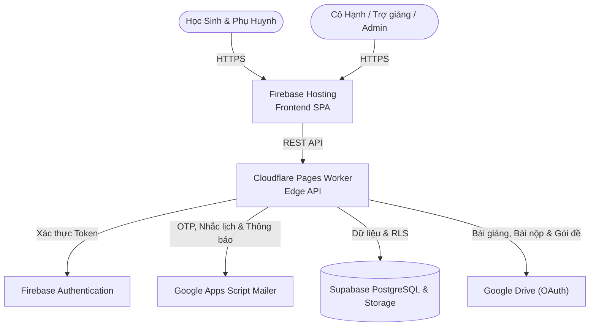

# TỔNG QUAN HỆ THỐNG QUẢN LÝ HỌC TẬP — LỚP TOÁN CÔ HẠNH (LTCH)
**Hệ thống số hóa quản lý học tập, bài giảng và điểm danh dành riêng cho Lớp Toán cô Hạnh**

---

## 1. THÔNG TIN DỰ ÁN

* **Tên hệ thống:** Hệ Thống Quản Lý Học Tập Lớp Toán cô Hạnh (LTCH)
* **Đơn vị vận hành:** Lớp Toán cô Hạnh
* **Tài khoản vận hành:** Cấu hình qua biến môi trường `ADMIN_EMAIL` / `DRIVE_OWNER_EMAIL` (mặc định mẫu: `admin@example.com`)
* **Kiến trúc triển khai:**
  * **Frontend Hosting:** Firebase Hosting (`your-firebase-project`)
  * **Backend API:** Cloudflare Pages Functions (`https://api.ltch.example.com`)
  * **Cơ sở dữ liệu:** Supabase PostgreSQL (`https://your-project.supabase.co`)

---

## 2. QUY MÔ & ĐẶC TẢ HOẠT ĐỘNG CỦA LỚP HỌC

* **Danh sách lớp:** Các lớp Khối 6 – 12 (6A..12A2) thuộc năm học `2026 - 2027` và có thể cấu hình động bởi Quản trị viên.
* **Khối lớp tiêu biểu:** 
  * Khối 12: Luyện thi THPTQG, ĐGNL HSA, ĐGTD TSA & Toán chuyên sâu.
  * Khối 11: Lượng giác, Đạo hàm, Tổ hợp, Hình học không gian.
  * Khối 10: Bất đẳng thức, Vectơ, Phương pháp tọa độ Oxy.
  * Khối 6 - 9: Các lớp nền tảng Toán THCS & Ôn thi vào lớp 10.
* **Thời lượng buổi học:** 2 - 3 tiếng / buổi học.

---

## 3. KIẾN TRÚC HẠ TẦNG KỸ THUẬT

### Chi tiết các tầng công nghệ:
1. **Frontend:** Giao diện SPA ES Modules (`client/`) đóng gói qua esbuild thành `public/app.js`, hỗ trợ KaTeX, MathLive, PDF.js, tương thích đa thiết bị.
2. **Hosting:** Firebase Hosting, tốc độ cao, SSL tự động và cấu hình CSP/headers bảo mật nghiêm ngặt.
3. **Edge API:** Cloudflare Pages Functions (`worker/`) xử lý REST API, xác thực Firebase ID token + OTP 2 lớp, rate-limiting, proxy phát video/tài liệu và bảo mật RLS.
4. **Cơ sở dữ liệu:** Supabase PostgreSQL với lịch sử migrations chuẩn hóa (`0001`–`0031`).
5. **Lưu trữ học liệu & Gói đề:** Google Drive (`DRIVE_OWNER_EMAIL`) lưu trữ bài giảng, bài nộp, tệp thông báo và gói đề phòng luyện kèm Supabase Storage làm lớp lưu trữ dự phòng.
6. **Gửi thư & OTP:** Google Apps Script thuộc sở hữu của tài khoản vận hành, có ký số HMAC bảo mật.

---

## 4. CÁC PHÂN HỆ CHỨC NĂNG CHÍNH

### 4.1. Bảng điều khiển (Dashboard) & Góc nhìn vai trò
- Thống kê thời gian thực: Lịch học, bài tập về nhà, đề luyện thi, thông báo chung/theo lớp.
- Phân quyền rành mạch theo 5 vai trò (`admin`, `teacher`, `assistant`, `student`, `parent`) và 7 quyền chi tiết cho Trợ giảng.

### 4.2. Luồng đăng ký & Phê duyệt hồ sơ thông minh
- Học sinh mới sau khi đăng nhập OTP tự động điền form hồ sơ: chọn ảnh nhận diện rõ mặt, chọn lớp học động, thông tin liên lạc học sinh và phụ huynh.
- Màn hình chờ duyệt kèm nút "Yêu cầu Quản trị viên duyệt gấp".
- Bảng điều khiển Quản trị với 3 thao tác: **Duyệt vào lớp**, **Yêu cầu chỉnh sửa**, và **Từ chối / Khóa**.

### 4.3. Quản lý Lớp học, Điểm danh, Thông báo & Diễn đàn
- Đăng tải bài giảng, video chữa đề, tài liệu có watermark bảo vệ theo tài khoản học sinh.
- Quản lý điểm danh từng buổi kèm hàng đợi gửi email báo chuyên cần và nhắc lịch học tự động.
- Thông báo chung/theo lớp kèm tệp đính kèm đa phương tiện và Diễn đàn lớp hỗ trợ công thức Toán học (LaTeX/MathLive).

### 4.4. Phòng luyện thi THPTQG · HSA · TSA & Ngân hàng câu hỏi Word
- Hỗ trợ 3 kỳ thi chuẩn (**THPTQG**, **HSA**, **TSA**) với 6 dạng câu hỏi, chế độ thi theo phần có thời gian chờ hoặc thi cả đề, lưu nháp tự động và chống thi nhiều thiết bị.
- Trình nhập đề trực tiếp từ file Word (`.docx`) theo 3 file mẫu chuẩn kèm xem trước công thức KaTeX và quản lý phiên bản câu hỏi / chữa đề chi tiết.
