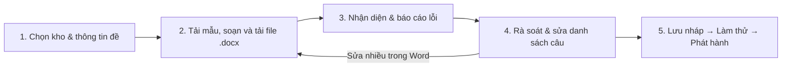
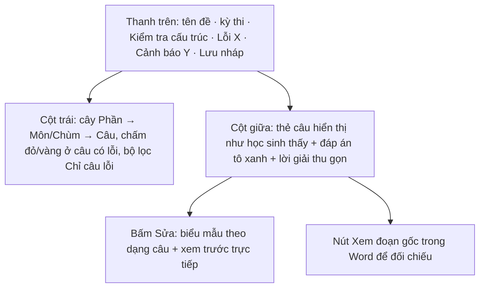

# Thiết kế Đăng tải Câu hỏi bằng File Word (THPTQG · HSA · TSA)

> [!IMPORTANT]
> **Nguyên tắc:** Người soạn gõ đề trong Word (`.docx`) theo **mẫu dòng lệnh `[...]` chuẩn của LTCH** (công thức gõ bằng **LaTeX** `$...$` / `$$...$$`, ký hiệu, bảng và hình ảnh chèn thẳng hàng với chữ) $\rightarrow$ hệ thống **tự nhận diện và trả ra danh sách câu hỏi** $\rightarrow$ người tải lên **đọc lại, sửa cho chính xác** $\rightarrow$ lưu thành **đề nháp** $\rightarrow$ **Làm thử** $\rightarrow$ **Phát hành**.
> Cách làm theo mô hình của `khaothi.online` (tải `.docx` $\rightarrow$ nhận diện tự động $\rightarrow$ rà soát danh sách câu), được thiết kế riêng cho 3 kỳ thi (**THPTQG**, **HSA**, **TSA**) và đầy đủ 6 dạng câu hỏi của TSA.

Tài liệu này bổ sung cho [practice-rooms-design.md](./practice-rooms-design.md) (mục 2.2 *Thêm câu hỏi / đề mới*).

---

## 0. Bộ 3 File Word Mẫu (Đã tạo sẵn kèm Hướng dẫn & Câu hỏi Điển hình)

Ba file mẫu `.docx` độc lập cho từng kỳ thi (chứa đầy đủ hướng dẫn quy ước lệnh `[...]`, bảng lệnh và bộ câu hỏi mẫu điển hình có công thức LaTeX, bảng số liệu, hình vẽ minh họa, đoạn ngữ liệu đọc hiểu và đủ 6 dạng câu TSA) nằm tại thư mục [`public/mau-dang-tai/`](../public/mau-dang-tai/):

1. **[Mau_dang_tai_THPTQG.docx](../public/mau-dang-tai/Mau_dang_tai_THPTQG.docx)** — Mẫu đề Toán THPTQG (Khối 10/11 theo form & Khối 12 thực chiến · 3 phần · 22 câu · 90 phút).
2. **[Mau_dang_tai_HSA.docx](../public/mau-dang-tai/Mau_dang_tai_HSA.docx)** — Mẫu đề ĐGNL ĐHQGHN (Phần 1 Định lượng · Phần 2 Định tính · Phần 3 gồm 5 môn Khoa học $\times 17$ câu + Tiếng Anh 50 câu, có cả câu đơn và chùm ngữ liệu).
3. **[Mau_dang_tai_TSA.docx](../public/mau-dang-tai/Mau_dang_tai_TSA.docx)** — Mẫu đề ĐGTD ĐH Bách Khoa Hà Nội (Phần 1 Toán học · Phần 2 Đọc hiểu · Phần 3 Giải quyết vấn đề · minh họa đủ 6 dạng câu: trắc nghiệm 1 đáp án, nhiều đáp án, đúng/sai nhiều mệnh đề & 1 nhận định, trả lời ngắn, điền khuyết `{{1}}`, kéo thả `[THẺ]`).

---

## 1. So sánh các phương án và lựa chọn

| Phương án | Ưu điểm | Nhược điểm | Kết luận |
| :--- | :--- | :--- | :--- |
| Nhập từng câu bằng form trên web | Chính xác từng trường | Rất chậm với đề 100–235 câu, khó chèn hình/bảng | Chỉ dùng để **sửa** sau khi nhận diện |
| Dán văn bản thô | Nhanh | Mất hình, bảng, gạch chân | Không dùng |
| Tải Excel/CSV | Dễ phân tích | Không chứa được hình, bảng, công thức dài, ngữ liệu | Không dùng |
| **Tải Word `.docx` theo mẫu lệnh `[...]` + rà soát** | Giáo viên quen Word; giữ được hình, bảng, định dạng; tải cả đề 1 lần | Cần quy ước cú pháp dòng lệnh `[...]` và bước kiểm tra | **Chọn** |

**Cách nhận diện được chọn:** Phân tích file `.docx` ngay trên trình duyệt của người tải (trong Web Worker), không gửi lên máy chủ để phân tích:
* File `.docx` là gói nén chứa `word/document.xml` và thư mục ảnh `word/media/`. Trình duyệt giải nén bằng thư viện nhỏ `fflate` (~8 KB) và đọc XML bằng `DOMParser`.
* Tự viết bộ đọc WordprocessingML thay vì dùng `mammoth.js`, vì cần biết chính xác: gạch chân, chỉ số trên/dưới, bảng và vị trí ảnh — các thứ mà chuyển sang HTML thông thường dễ làm mất.
* Không phân tích trên Cloudflare Worker để tránh giới hạn CPU khi đề lớn; **máy chủ vẫn kiểm tra lại toàn bộ dữ liệu** khi lưu (không tin dữ liệu từ trình duyệt).
* Tận dụng sẵn `katex` (kiểm tra và hiển thị công thức LaTeX), `mathlive` và [`client/question-math-editor.mjs`](../client/question-math-editor.mjs) (sửa công thức trên màn hình rà soát) đã có trong dự án.

---

## 2. Luồng thao tác 5 bước



1. **Chọn kho & thông tin đề (form trên web – là nguồn chính thức):** Kỳ thi (`THPTQG` / `HSA` / `TSA`), khối (THPTQG: 10/11/12), năm học, mã đề, tên đề, thời lượng mặc định theo kỳ thi. Chỉ hiện các kho mà người dùng có quyền (`canManagePracticePool`).
2. **Tải mẫu & tải file:** Nút **`Tải file mẫu`** riêng cho từng kỳ thi (tải đúng file trong `public/mau-dang-tai/`). Kéo thả file `.docx` vào ô tải lên. Đề lớn (HSA 235 câu) được phép tải **nhiều file theo từng phần**.
3. **Nhận diện:** Thanh tiến độ, sau đó hiện báo cáo: số câu nhận được theo từng phần, số **Lỗi** (chặn lưu) và **Cảnh báo** (cho lưu nhưng nên xem).
4. **Rà soát & sửa:** Màn hình danh sách câu hiển thị **đúng như học sinh sẽ thấy**, sửa trực tiếp từng câu (mục 6).
5. **Lưu nháp $\rightarrow$ Làm thử $\rightarrow$ Phát hành:** Lưu thành đề `draft`, bấm **`Làm thử`** (lượt `is_preview = true`) để kiểm tra lần cuối, rồi **`Phát hành`** khi đủ cấu trúc.

---

## 3. Quy ước soạn file Word (Cú pháp Dòng lệnh `[...]` chuẩn LTCH)

### 3.1. Quy tắc chung (Đã chốt)
* Lưu đúng định dạng **`.docx`** (không nhận `.doc`, `.docm` có macro).
* Hệ thống **chỉ đọc phần nằm giữa `[BẮT ĐẦU ĐỀ]` và `[KẾT THÚC ĐỀ]`**. Nhờ vậy, toàn bộ phần hướng dẫn ở đầu file mẫu có thể giữ nguyên mà không ảnh hưởng tới việc nhận diện.
* **Mọi dòng lệnh bắt đầu bằng cặp ngoặc vuông `[...]` ở đầu dòng** (như thẻ code để dễ phân biệt tuyệt đối với nội dung đề), ví dụ: `[CÂU]`, `[A]`, `[Ý a]`, `[ĐÁP ÁN]`, `[LỜI GIẢI]`. Không phân biệt chữ hoa/thường hay có dấu/không dấu (`[DAP AN]` vẫn nhận).
* **Lệnh nhiều dòng:** Nội dung viết ngay sau lệnh trên cùng dòng và được phép kéo dài xuống các dòng dưới (kể cả bảng, hình ảnh) cho tới khi gặp dòng lệnh `[...]` kế tiếp — áp dụng cho `[NGỮ LIỆU]`, `[CÂU]`, `[A]`..`[F]`, `[Ý a]`..`[Ý e]`, `[LỜI GIẢI]`.
* **Lệnh một dòng:** Chỉ lấy nội dung trên chính dòng đó — áp dụng cho `[KỲ THI]`, `[KHỐI]`, `[NĂM HỌC]`, `[MÃ ĐỀ]`, `[TÊN ĐỀ]`, `[PHẦN ...]`, `[MÔN]`, `[DẠNG]`, `[THẺ]`, `[ĐÁP ÁN]`, `[GHI CHÚ]`.
* **Không cần gõ số thứ tự câu** và **không dùng đánh số/gạch đầu dòng tự động** của Word trong phần đề — hệ thống tự động đánh số câu theo thứ tự xuất hiện.
* **Công thức toán học / ký hiệu:** Gõ trực tiếp bằng **LaTeX** trong `$...$` (nằm trên cùng dòng chữ) hoặc `$$...$$` (đứng riêng một dòng). Ví dụ: `$\int_0^3 2x\,dx = 9$`. Hệ thống chỉ dùng LaTeX (không dùng Equation của Word hay đối tượng MathType).
* **Hình ảnh:** Chèn ảnh ở chế độ **In Line with Text** ngay tại vị trí cần hiển thị (trong đề, phương án hay lời giải đều được). Chỉ dùng ảnh PNG/JPG, mỗi ảnh tối đa 2 MB.
* **Bảng:** Dùng bảng Word bình thường; hệ thống giữ nguyên hàng/cột và hiển thị công thức LaTeX trong ô.
* **Định dạng chữ được giữ:** **in đậm**, *in nghiêng*, <u>gạch chân</u> (dùng cho câu hỏi tiếng Việt/tiếng Anh có từ gạch chân của HSA/TSA), chỉ số trên/dưới. Màu chữ, phông chữ, cỡ chữ bị bỏ qua.
* **Đáp án đúng chỉ khai báo bằng lệnh `[ĐÁP ÁN]`:** Tuyệt đối không nhận đáp án qua việc gạch chân hay tô màu chữ cái phương án (để không bao giờ nhầm với nội dung có gạch chân trong đề).
* **Không cần trường Chủ đề:** Câu hỏi không gắn nhãn chủ đề; trang kết quả tập trung vào thống kê Tổng quan, Theo dạng câu và lời giải chi tiết từng câu.

### 3.2. Bảng lệnh đầy đủ

| Lệnh đầu dòng | Ý nghĩa | Ví dụ | Dùng cho |
| :--- | :--- | :--- | :--- |
| `[BẮT ĐẦU ĐỀ]` / `[KẾT THÚC ĐỀ]` | Đánh dấu vùng nội dung đề mà hệ thống sẽ đọc | `[BẮT ĐẦU ĐỀ]` | Cả 3 |
| `[KỲ THI]` | Kỳ thi của đề (`THPTQG`, `HSA`, `TSA`) | `[KỲ THI] THPTQG` | Cả 3 |
| `[KHỐI]` / `[NĂM HỌC]` | Khối lớp (`10`, `11`, `12`) và niên khóa | `[KHỐI] 12` | THPTQG |
| `[MÃ ĐỀ]` / `[TÊN ĐỀ]` | Mã đề và tên đề hiển thị cho học sinh | `[MÃ ĐỀ] 01` | Cả 3 |
| `[PHẦN I]` `[PHẦN II]` `[PHẦN III]` | Bắt đầu từng phần của đề THPTQG | `[PHẦN II]` | THPTQG |
| `[PHẦN 1]` `[PHẦN 2]` `[PHẦN 3]` | Bắt đầu từng phần của đề HSA / TSA | `[PHẦN 3]` | HSA, TSA |
| `[MÔN]` | Môn trong Phần 3 HSA (`VẬT LÍ`, `HÓA HỌC`, `SINH HỌC`, `LỊCH SỬ`, `ĐỊA LÍ`, `TIẾNG ANH`) | `[MÔN] VẬT LÍ` | HSA |
| `[NGỮ LIỆU]` … `[HẾT NGỮ LIỆU]` | Đoạn văn/bảng/hình dùng chung; các `[CÂU]` nằm giữa hai lệnh thuộc cùng một chùm (`cluster_id`) | `[NGỮ LIỆU] Đọc đoạn trích...` | HSA, TSA |
| `[CÂU]` | Bắt đầu một câu hỏi mới | `[CÂU] Cho hàm số $y=f(x)$...` | Cả 3 |
| `[DẠNG]` | Khai báo dạng câu đặc biệt trong TSA (`NHIỀU ĐÁP ÁN` hoặc `ĐÚNG SAI`) | `[DẠNG] NHIỀU ĐÁP ÁN` | TSA |
| `[A]` `[B]` `[C]` `[D]` (`[E]` `[F]`) | Các phương án lựa chọn | `[A] $24$` | Cả 3 |
| `[Ý a]` `[Ý b]` `[Ý c]` `[Ý d]` (`[Ý e]`) | Các mệnh đề Đúng/Sai | `[Ý a] Hàm số đồng biến...` | THPTQG, TSA |
| `{{1}}` `{{2}}` … | Vị trí ô trống viết ngay trong thân câu (điền khuyết hoặc kéo thả) | `...nhóm chức {{1}} và {{2}}.` | TSA |
| `[THẺ]` | Một thẻ đáp án kéo thả (hệ thống tự gán mã `T1, T2, ...` theo thứ tự xuất hiện) | `[THẺ] 170 chiếc` | TSA |
| `[ĐÁP ÁN]` | Đáp án đúng (**bắt buộc**, cách ghi theo bảng 3.3) | `[ĐÁP ÁN] C` | Cả 3 |
| `[LỜI GIẢI]` | Lời giải chi tiết (có thể nhiều dòng, chèn hình, bảng) | `[LỜI GIẢI] Ta có...` | Cả 3 |
| `[GHI CHÚ]` | Ghi chú riêng cho người soạn (hệ thống tự bỏ qua) | `[GHI CHÚ] Kiểm tra lại hình` | Cả 3 |

### 3.3. Hệ thống tự nhận diện dạng câu & cách ghi `[ĐÁP ÁN]`

| Dạng câu (`type`) | Nhận diện khi | Cách ghi `[ĐÁP ÁN]` | Kỳ thi |
| :--- | :--- | :--- | :--- |
| Trắc nghiệm 1 đáp án (`single`) | Có đủ `[A]`–`[D]` và không có `[DẠNG]` | `[ĐÁP ÁN] B` | Cả 3 |
| Chọn nhiều đáp án (`multiple`) | Có `[DẠNG] NHIỀU ĐÁP ÁN` và `[A]`–`[F]` | `[ĐÁP ÁN] A, C, E` | TSA |
| Đúng/Sai nhiều mệnh đề (`true_false`) | Có `[Ý a]`… (THPTQG đúng 4 mệnh đề; TSA 2–5 mệnh đề) | `[ĐÁP ÁN] Đ S Đ Đ` | THPTQG, TSA |
| Đúng/Sai một nhận định (`true_false`, 1 mệnh đề) | Có `[DẠNG] ĐÚNG SAI`, không có `[Ý ...]` | `[ĐÁP ÁN] S` | TSA |
| Trả lời ngắn (`short`) | Không có phương án, không có `{{n}}` | `[ĐÁP ÁN] 12` hoặc `[ĐÁP ÁN] 2,5 \| 5/2` (ngăn các cách ghi đúng bằng `\|`) | Cả 3 |
| Điền khuyết trong câu (`fill_blank`) | Trong câu có `{{1}}`, `{{2}}`… và không có `[THẺ]` | `[ĐÁP ÁN] (1) 88` hoặc `[ĐÁP ÁN] (1) T \| thymine; (2) U \| uracil` | TSA |
| Kéo thả (`drag_drop`) | Trong câu có `{{1}}`, `{{2}}`… và có các dòng `[THẺ]` | `[ĐÁP ÁN] (1) T4; (2) T1; (3) T2` (thẻ không dùng là thẻ gây nhiễu) | TSA |

Điểm câu **không ghi trong file**: hệ thống tự gán theo kỳ thi và phần (THPTQG: 0,25 / 1,0 theo bậc / 0,5; HSA và TSA: 1 điểm/câu, câu nhiều ý/ô của TSA phải đúng hết mới có điểm) đúng như mục 8 của tài liệu thiết kế chính.

### 3.4. Ví dụ minh họa cú pháp `[...]`

````carousel
```text
[BẮT ĐẦU ĐỀ]
[KỲ THI] THPTQG
[KHỐI] 12
[NĂM HỌC] 2026-2027
[MÃ ĐỀ] 01
[TÊN ĐỀ] Đề thi thử THPTQG năm 2027 – Mã đề 01 – Toán

[PHẦN I]
[CÂU] Cho $f(x)$ là hàm số liên tục trên đoạn $[a;b]$ và $k$ là một số thực. Khẳng định nào sau đây đúng?
[A] $\int_a^b f(x)\,dx = f(b)-f(a)$.
[B] $\int_a^b k f(x)\,dx = k\int_a^b f(x)\,dx$.
[C] $\int_a^b f(x)\,dx = \int_b^a f(x)\,dx$.
[D] $\int_a^b [f(x)]^2\,dx = \left(\int_a^b f(x)\,dx\right)^2$.
[ĐÁP ÁN] B
[LỜI GIẢI] Theo tính chất của tích phân, hằng số $k$ được đưa ra ngoài dấu tích phân nên B đúng.

[PHẦN II]
[CÂU] Cho hàm số $y=x^3-3x+1$. Xét tính đúng, sai của các mệnh đề sau:
[Ý a] Hàm số đồng biến trên khoảng $(1;+\infty)$.
[Ý b] Hàm số có 3 điểm cực trị.
[Ý c] Đồ thị hàm số cắt trục tung tại điểm có tung độ bằng $1$.
[Ý d] Giá trị cực tiểu của hàm số bằng $-1$.
[ĐÁP ÁN] Đ S Đ Đ
[LỜI GIẢI] $y'=3x^2-3=0 \Leftrightarrow x=\pm 1$...

[PHẦN III]
[CÂU] Tính tích phân $I=\int_0^3 (2x+1)\,dx$.
[ĐÁP ÁN] 12
[LỜI GIẢI] $I=\left(x^2+x\right)\Big|_0^3=9+3=12$.
[KẾT THÚC ĐỀ]
```
<!-- slide -->
```text
[BẮT ĐẦU ĐỀ]
[KỲ THI] HSA
[MÃ ĐỀ] 02
[TÊN ĐỀ] Đề ôn tập ĐGNL ĐHQG HN năm 2027 – Mã đề 02

[PHẦN 1]
[CÂU] Chu kì của hàm số $y=\sin\left(\dfrac{2}{5}x\right)\cos\left(\dfrac{2}{5}x\right)$ là $k\pi$. Giá trị của $k$ là
[ĐÁP ÁN] 2,5 | 5/2
[LỜI GIẢI] $y=\dfrac12\sin\left(\dfrac45x\right)$ có chu kì $T=\dfrac{5\pi}{2} \Rightarrow k=2{,}5$.

[PHẦN 3]
[MÔN] VẬT LÍ
[CÂU] Hai quả cầu dẫn điện giống hệt nhau được tích điện $+2Q$ và $-Q$...
(chèn ảnh In Line with Text ngay tại đây)
[A] $2F_1=F_2$
[B] $F_1=F_2$
[C] $F_1=2F_2$
[D] $F_1=8F_2$
[ĐÁP ÁN] D
[LỜI GIẢI] ...
[KẾT THÚC ĐỀ]
```
<!-- slide -->
```text
[BẮT ĐẦU ĐỀ]
[KỲ THI] TSA
[MÃ ĐỀ] 08
[TÊN ĐỀ] Đề ôn tập ĐGTD ĐHBK HN năm 2027 – Mã đề 08

[PHẦN 1]
[CÂU] Trong các số sau, số nào là số nguyên tố?
[DẠNG] NHIỀU ĐÁP ÁN
[A] $2$
[B] $9$
[C] $11$
[D] $15$
[E] $17$
[F] $21$
[ĐÁP ÁN] A, C, E
[LỜI GIẢI] $2, 11, 17$ là số nguyên tố.

[CÂU] Giới hạn $\lim\limits_{x\to4}\dfrac{f^2(x)+f(x)-30}{\sqrt x-2}$ bằng {{1}}.
[ĐÁP ÁN] (1) 88

[CÂU] Một công ty có chi phí sản xuất... Kéo thả các ô vào vị trí thích hợp:
Với đơn hàng gồm $x$ chiếc $(100<x<300)$, giá bán mỗi chiếc là {{1}} (USD).
Lợi nhuận của công ty từ đơn hàng đó là {{2}} (USD).
Công ty đạt lợi nhuận lớn nhất khi đơn hàng có {{3}}.
[THẺ] $85x-0{,}25x^2$
[THẺ] 170 chiếc
[THẺ] $90-0{,}25x$
[THẺ] $115-0{,}25x$
[ĐÁP ÁN] (1) T4; (2) T1; (3) T2
[KẾT THÚC ĐỀ]
```
````

---

## 4. Bộ nhận diện hoạt động thế nào

1. **Kiểm tra file an toàn:** Chỉ nhận `.docx`, tối đa 20 MB; dừng nếu tổng dung lượng giải nén vượt 100 MB hoặc quá 2.000 tệp con (chống file nén độc hại). Chạy trong Web Worker nên trình duyệt không bị treo.
2. **Đọc nội dung theo đúng thứ tự** từ `word/document.xml` trong phạm vi giữa `[BẮT ĐẦU ĐỀ]` và `[KẾT THÚC ĐỀ]`: từng đoạn văn, đoạn chữ có định dạng, bảng, ảnh (tra đường dẫn ảnh qua `word/_rels/document.xml.rels`).
3. **Chuyển về chuỗi nội dung chuẩn LTCH** (giống định dạng `prompt` hiện có): chữ thường + LaTeX `$...$`; định dạng giữ lại bằng tập thẻ được phép duy nhất `b, i, u, sup, sub, br, table, tr, td, th` và ảnh dưới dạng tham chiếu `[[img:<id>]]`. Mọi thẻ khác bị loại bỏ khi hiển thị (chống chèn mã độc).
4. **Tách khối theo dòng lệnh `[...]`** (`[PHẦN ...]`, `[MÔN]`, `[NGỮ LIỆU]`..`[HẾT NGỮ LIỆU]`, `[CÂU]`, `[DẠNG]`, `[A]`..`[F]`, `[Ý a]`..`[Ý e]`, `[THẺ]`, `[ĐÁP ÁN]`, `[LỜI GIẢI]`, `[GHI CHÚ]`) bằng máy trạng thái; mỗi câu ghi nhớ **đoạn gốc trong Word** để hiển thị khi rà soát.
5. **Suy ra dạng câu và đáp án** theo bảng 3.3, tự đánh số câu và gán phần, môn, chùm ngữ liệu, thang điểm.
6. **Kiểm tra** từng câu và toàn đề (mục 5), tạo báo cáo Lỗi/Cảnh báo kèm số câu, vị trí và gợi ý sửa.

---

## 5. Danh sách kiểm tra

### 5.1. Lỗi (chặn lưu)
* Thiếu cặp `[BẮT ĐẦU ĐỀ]` … `[KẾT THÚC ĐỀ]`.
* Câu thiếu `[ĐÁP ÁN]`, hoặc đáp án không khớp dạng (ví dụ `[ĐÁP ÁN] E` khi chỉ có `[A]`–`[D]`; số Đ/S khác số mệnh đề; số đáp án điền khuyết khác số ô `{{n}}`; mã thẻ `T7` không tồn tại).
* Công thức LaTeX sai cú pháp (KaTeX báo lỗi) — chỉ rõ công thức và câu.
* Câu hoặc phương án rỗng; trùng ký hiệu phương án (`[B]` xuất hiện 2 lần trong cùng 1 câu).
* Dạng câu không được phép trong kỳ thi/phần đó (ví dụ `[DẠNG] NHIỀU ĐÁP ÁN` trong THPTQG; câu Đúng/Sai trong HSA).
* Ảnh không đọc được (`WMF/EMF`), ảnh lớn hơn 2 MB, hoặc chèn công thức Equation/MathType chưa chuyển sang LaTeX `$...$`.
* `[NGỮ LIỆU]` không có `[HẾT NGỮ LIỆU]`, hoặc ngữ liệu không có câu nào ở giữa.

### 5.2. Cảnh báo (cho lưu, nên xem)
* Ảnh để chế độ trôi nổi (có thể sai vị trí); có dùng đánh số tự động của Word.
* Câu chưa có `[LỜI GIẢI]`.
* Câu giống gần như hệt một câu đã có trong kho (so sánh nội dung đã chuẩn hóa) $\rightarrow$ gợi ý mã câu trùng `#LTCH-xxxx` (*giai đoạn 2*).
* Thông tin `[KỲ THI]` / `[MÃ ĐỀ]` trong file khác với form đã chọn ở bước 1.

### 5.3. Kiểm tra cấu trúc đề (bắt buộc đủ trước khi **Phát hành**, cho phép lưu nháp khi chưa đủ)

| Kỳ thi | Yêu cầu |
| :--- | :--- |
| **THPTQG** (Khối 10/11/12) | Phần I: 12 câu `single` · Phần II: 4 câu `true_false` đúng 4 mệnh đề · Phần III: 6 câu `short` · Tổng 22 câu |
| **HSA** | Phần 1: 50 câu (`single`/`short`) · Phần 2: 50 câu · Phần 3: mỗi môn Lí, Hóa, Sinh, Sử, Địa **đúng 17 câu** và có **ít nhất 1 câu đơn**, Tiếng Anh **50 câu** |
| **TSA** | Phần 1: 40 câu · Phần 2: 20 câu · Phần 3: 40 câu · đủ 6 dạng được phép · Đúng/Sai 1–5 mệnh đề |

Thanh kiểm tra hiển thị dạng `Phần I 12/12 ✓ · Phần II 3/4 ✕ · Phần III 6/6 ✓` ở đầu màn hình rà soát.

---

## 6. Màn hình Rà soát & Sửa (100% nền sáng, theo skill UI/UX của dự án)



* **Thẻ câu:** Số câu, nhãn dạng (`Trắc nghiệm`, `Nhiều đáp án`, `Đúng/Sai`, `Trả lời ngắn`, `Điền khuyết`, `Kéo thả`), phần/môn, danh sách lỗi ngay trên thẻ (bấm vào sẽ nhảy đúng vị trí cần sửa).
* **Biểu mẫu sửa theo dạng câu:** Ô nội dung có trình soạn công thức LaTeX (dùng lại `question-math-editor.mjs`), thêm/bớt phương án hoặc mệnh đề trong giới hạn của kỳ thi, chọn đáp án bằng nút bấm, chèn/thay ảnh, ô lời giải. Xem trước cập nhật ngay.
* **Thao tác trên danh sách:** `Tách câu`, `Gộp với câu trên`, `Xóa câu`, `Kéo đổi thứ tự`, `Đổi dạng câu`, `Đưa vào/ra chùm ngữ liệu`.
* **Tải lại file:** Chọn **Thay toàn bộ** hoặc **Thay riêng một phần/môn**; hệ thống cảnh báo các chỉnh sửa tay trong phạm vi bị thay sẽ mất.
* **Tự lưu nháp nhập liệu** vào `localStorage` để không mất công sửa khi lỡ đóng trang.
* **Sau khi đề đã phát hành:** Áp dụng quy tắc mục 2.2 tài liệu chính — chỉ sửa trên chính câu đó (lên phiên bản mới), **khóa đổi dạng câu, điểm và cách tính điểm**; muốn thay câu thì câu mới phải cùng phần, cùng dạng, cùng thang điểm.

---

## 7. Dữ liệu, lưu trữ và API

**Mở rộng cấu trúc câu hỏi** (tham chiếu [`worker/questions.mjs`](../worker/questions.mjs)):

| `type` | Trường bổ sung |
| :--- | :--- |
| `single` | `options[4]`, `answer` |
| `multiple` | `options[2..6]`, `answers: number[]` |
| `true_false` | `statements[1..5]` (THPTQG bắt buộc 4), `answers: boolean[]`, `weights` |
| `short` | `accepted: string[]` |
| `fill_blank` | `blanks: [{ accepted: string[], kind: 'number' \| 'text' }]` |
| `drag_drop` | `cards: string[]`, `answer: number[]` (chỉ số thẻ theo từng ô) |

Mọi câu có thêm: `media: [{id, path, width, height}]`, `passage_id`, `subject_code`, `source_ref` (vị trí trong file gốc).

**Bảng mới `ltch_question_imports`:** `id`, `exam_id`, `exam_type`, `uploaded_by`, `file_path`, `file_sha256`, `status` (`parsed` / `saved` / `discarded`), `report jsonb` (số câu, lỗi, cảnh báo), `created_at`. Giữ lại **file Word gốc** để đối chiếu và truy vết.

**Lưu trữ (bucket hiện có `ltch-materials`):**
* File gốc: `question-imports/<importId>.docx`.
* Ảnh câu hỏi: `question-media/<sha256>.<png|jpg|webp|gif>` — đặt tên theo mã băm nên ảnh trùng chỉ lưu 1 lần; chỉ nhận PNG/JPG/WEBP/GIF $\le 2\text{ MB}$.

**API (đều kiểm tra quyền `canManagePracticePool` theo kỳ thi và khối):**
* `POST /api/admin/question-imports` – tải file gốc + thông tin đề, trả `importId`.
* `POST /api/admin/question-imports/:id/media` – tải ảnh đã tách (kiểm tra loại tệp thật bằng chữ ký đầu tệp, không tin phần đuôi).
* `POST /api/admin/exams` / `PUT /api/admin/exams/:id` – lưu đề nháp kèm danh sách câu (giới hạn 2 MB). Máy chủ **kiểm tra lại toàn bộ**: cấu trúc từng dạng câu, công thức LaTeX, ảnh thuộc đúng `importId`, rồi cấp mã `#LTCH-xxxx` và `version: 1` cho câu mới.
* `POST /api/admin/exams/:id/publish` – chỉ thành công khi đạt toàn bộ mục 5.3.

---

## 8. Lộ trình triển khai

| Giai đoạn | Nội dung |
| :--- | :--- |
| **1 – Cốt lõi** | 3 file mẫu `.docx`; bộ nhận diện dòng lệnh `[...]` + LaTeX `$...$` + ảnh + bảng + gạch chân; đủ 6 dạng câu; báo cáo Lỗi/Cảnh báo; màn hình rà soát & sửa; lưu nháp, làm thử, phát hành; mở rộng `questions.mjs` và `practice-engine.js` |
| **2 – Tiện ích** | Phát hiện câu trùng trong kho; thay riêng từng phần/môn khi tải lại |
| **3 – Nâng cao** | Xuất ngược đề ra `.docx` theo đúng mẫu lệnh `[...]` để sửa hàng loạt rồi tải lại; dùng chung bộ nhập cho bài kiểm tra trên lớp |
